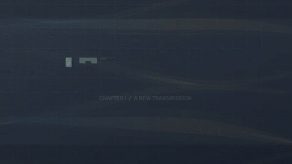
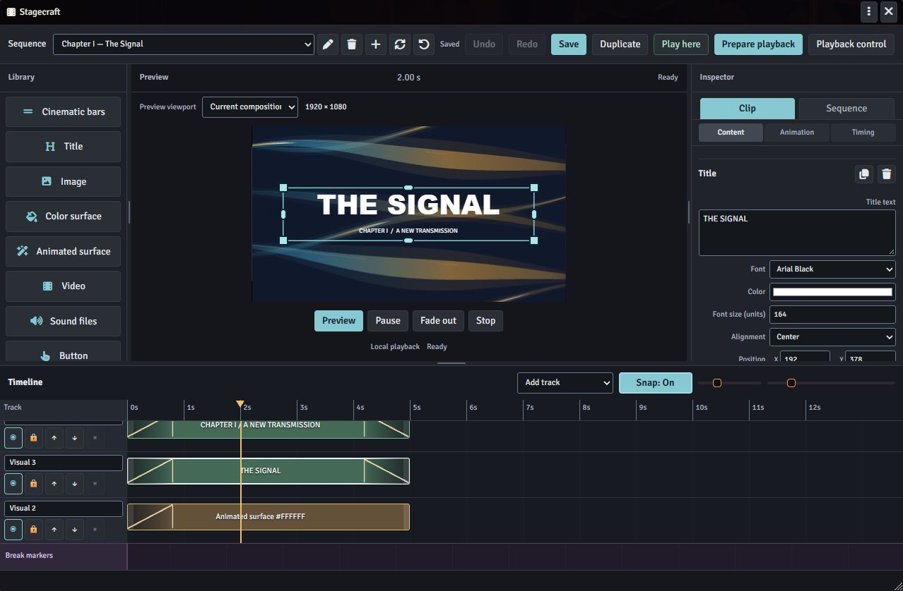
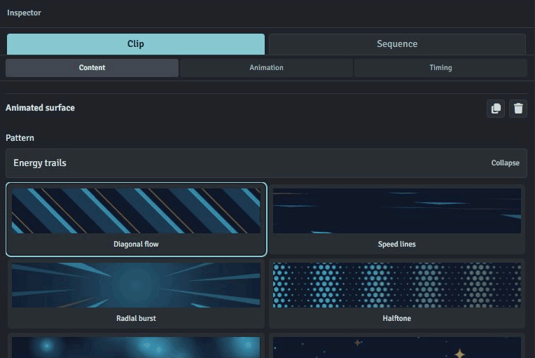
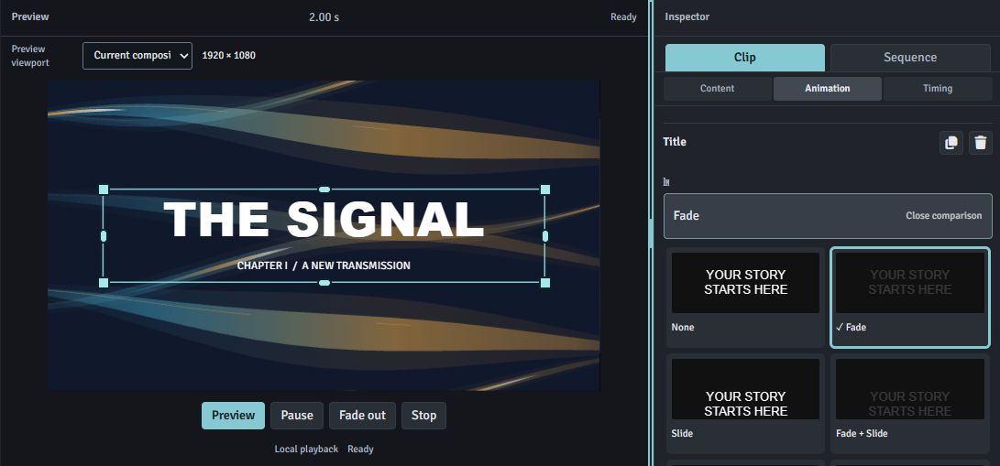
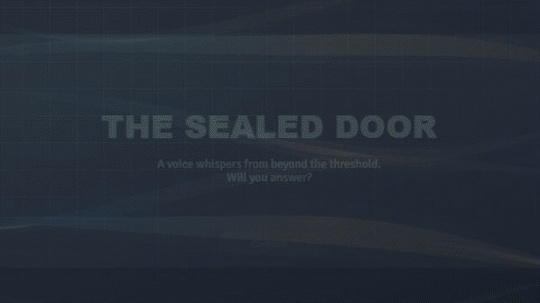

# Stagecraft

**Motion & Interaction Studio for Foundry VTT**

Build animated introductions, visual effects and interactive sequences inside Foundry. Arrange text, images, video, sound and effects on a multitrack timeline, preview your work, then play it for the players you choose.

**Foundry VTT 14 · Version 0.19.7 · English and German interface · MIT license**

**22 animated surface patterns · 33 title animation presets · 8 creative elements**

[Get started](docs/getting-started.md) · [Follow a tutorial](docs/tutorials.md) · [Settings & troubleshooting](docs/reference.md)





## What you can create

- **Chapter and character reveals:** combine cinematic bars, animated titles, portraits and sound.
- **Transitions and intermissions:** layer videos, polygon masks, color surfaces and animated patterns. Style them with blend modes, outlines, shadows and glow.
- **Player-paced scenes:** place breaks between passages and add Continue buttons so each player can read at their own pace.
- **Choices you can follow in chat:** design choice buttons that post a prepared message publicly or to the GM, then continue that player's sequence.
- **Combat presentations:** start saved sequences automatically at combat start/end or turn start/end, with optional character filters.

## Explore the presets

Compare moving previews side by side before choosing a pattern or animation. Start with a preset, adjust its settings and colors, then save your own element or animation templates.

| Built in | What you can use |
| --- | --- |
| **22 animated surface patterns** | Anime speed lines, halftone, starfields, neon grids, circuit traces, energy trails, aurora and more. |
| **33 title animation presets** | Five standard motions and 28 text effects, available for both In and Out, with separate timing and easing. |
| **5 standard visual animations** | Fade, Slide, Fade + Slide, Zoom and Fade + Zoom for images, videos, surfaces and buttons. Cinematic bars offer Fade, Slide and Fade + Slide. |
| **8 creative elements, plus Break markers** | Cinematic bars, titles, images, color surfaces, animated surfaces, video, sound and interactive buttons. |
| **4 original button textures** | Diagonal, facets, grain and honeycomb, with editable shapes and support for your own background images. |



Bring your own **images, video and audio** through Foundry's file picker. Combine polygon masks, blend modes, outlines, shadows and glow; add optional color keying to video. Use animated backgrounds and titles without supplying external media.

## Build, preview, play

The editor has an element library, a central preview, a clip/sequence inspector and a resizable multitrack timeline.

1. Add elements from the library. Move and trim clips on the timeline; use snapping, copy/paste and Undo/Redo as you arrange them.
2. Position and resize visual elements in the preview. Choose separate In/Out animations using animated comparison previews.
3. Save elements and animation settings as templates to reuse your designs.
4. Preview the sequence, choose your audience and prepare playback. Start the prepared run from Playback control when the participants are ready.

Display sequences over the canvas or the whole window. Runs for separate audiences can play in parallel; starts with overlapping audiences queue. Players retain a local exit and personal volume control even when a sequence blocks input.

## Install

1. In Foundry's Setup screen, open **Add-on Modules → Install Module**.
2. Paste this address into **Manifest URL**, then select **Install**:

   ```text
   https://github.com/Rhapsody-Sky/FoundryVTT-Stagecraft/releases/latest/download/module.json
   ```

3. In your world, enable **Stagecraft** under **Manage Modules**.
4. For later versions, use **Update** or **Update All** in Setup, then reload participating GM/player clients with **Ctrl+F5**.

For manual installation, download `stagecraft.zip` from [Releases](https://github.com/Rhapsody-Sky/FoundryVTT-Stagecraft/releases/latest), extract it into `Data/modules/stagecraft`, and restart Foundry if needed. The folder must directly contain `module.json`.

## Your first animated title

1. As GM, open the clapperboard **Stagecraft** tool in Foundry's scene controls and choose **Open editor**.
2. Choose **New sequence** and give it a name.
3. Add a **Title** from the library. In **Clip → Content**, enter your text and adjust its appearance and position.
4. Open **Clip → Animation**. Choose an In preset and an Out preset, then adjust their durations.
5. Set the clip's start and length in **Clip → Timing**, or move and trim it on the timeline.
6. Use **Preview** to check the result. Save the sequence.
7. Choose **Prepare playback**, select the recipients and prepare the run. In **Playback control**, select it and choose **Start playback** when it is ready.

**Play here** displays the sequence on your own client. **Preview** stays inside the editor.



Follow [Getting started](docs/getting-started.md) for audience selection, or try the [chapter reveal tutorial](docs/tutorials.md#reveal-a-chapter-title).

## Interactive reading and choices

Add a **Break** from the library and place its marker below the timeline. Include a **Button** that is visible at that break.

- **Continue for this player** advances only the viewer who clicks it. Other viewers remain at their own positions. At the sequence’s final hold, it finishes that viewer’s sequence using the sequence fade.
- **Choice** posts the prepared chat message with the player's selection, then advances that player. Choose whether everyone or only the GM can see the message.
- Give related choice buttons the same **Question group** so they represent alternatives for the same decision.

The GM can still advance or end playback from Playback control. Closing that panel does not stop a run; reopen it through **Stagecraft → Playback control**.



*The sequence waits at a Break until Continue is clicked, then reveals the next passage.*

Build your own [player-paced scene or choice](docs/tutorials.md#let-each-player-read-at-their-own-pace). The [reference](docs/reference.md) explains media behavior at a Break, sequence endings and viewer controls.

## Updates and support

Before updating, save open edits and back up your Foundry world. All participants should run the same module version.

For a bug report, include your Foundry and Stagecraft versions, the affected element, whether it happens in Preview or player playback, and the shortest steps that reproduce it. Remove private media paths and player information from screenshots or logs.

## License

Stagecraft is available under the [MIT license](LICENSE).
